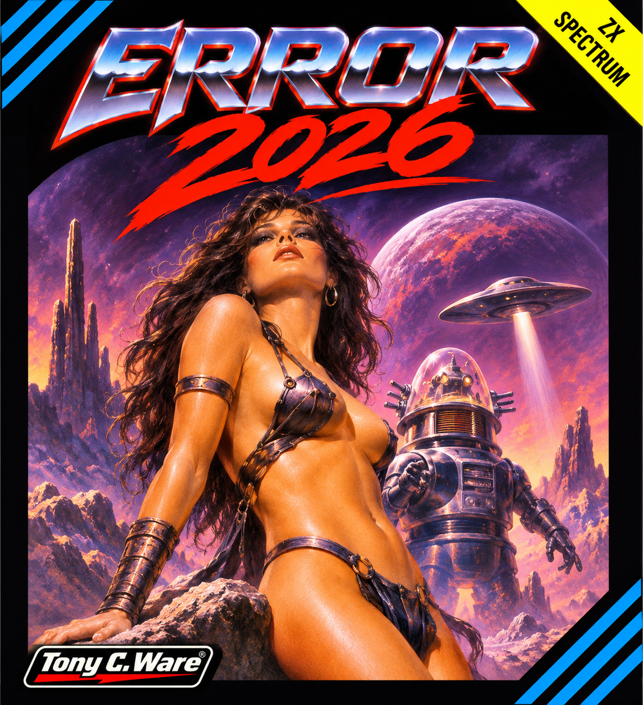

# ERROR 2026

**2026… EL FUTURO** · Videojuego arcade para **ZX Spectrum 48K PAL** · **V1.0** · **Tony C. Ware**

> La humanidad ha entregado su felicidad a SMILEY, una inteligencia artificial que hará lo que sea necesario para mantenerla. Incluso matar.

Un ciudadano desconocido, armado con la última pistola que existe —la **Magnum 3000**— intenta escapar de la utopía homicida. Los compuzoides de SMILEY no lo permitirán.

## El juego

30 pantallas, 6 sectores, duelo final de cada sector contra **SMILEY**. Los compuzoides son **Interceptor** (verde), **Terminador** (cian), **Tanque** (rojo) y **Acechador** (magenta).

## Jugar

Descarga el archivo **ERROR_2026_V1_0_48K.tap** de [Releases](https://github.com/OnRail76/ERROR-2026/releases). Abre un emulador de ZX Spectrum 48K PAL. Si aparece BASIC, escribe `LOAD ""` y carga la cinta.

**Q/A/O/P**: mover arriba/abajo/izquierda/derecha; combinaciones para diagonales. **SPACE** o **FIRE (Kempston)**: disparar en la última dirección de movimiento. SPACE/FIRE inicia la partida; el joystick Kempston se activa al usar FIRE.

## Código fuente y documentación

La distribución V1.0 contiene el TAP, las fuentes ensamblador Z80, herramientas Python, pruebas, capturas reales, manual/atlas PDF y carátula oficial PNG sin recortar. Para compilar desde `fuentes/`:

```bash
python3 tools/build_error_2026.py
python3 build.py
python3 tests/test_error2026.py
python3 tests/test_error2026_waves.py
```

El TAP oficial V1.0 tiene SHA-256:

```
a74fb8ff17c40945e8edb22d9849537d6db884059f9420c3068a03386fa5de37
```

**Licencias:** código y herramientas bajo MIT (© 2026 Tony C. Ware). Arte gráfico, carátula y logotipos conservan sus derechos separados; consultar `fuentes/LICENCIA_GRAFICOS.md` en el paquete.

© 2026 **Tony C. Ware**.
